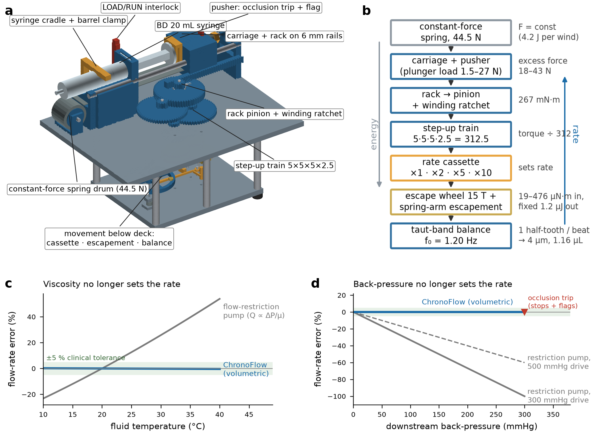

# ChronoFlow

**An electricity-free, volumetric, clockwork-governed syringe infusion driver for neonatal care in low-resource settings.**

Design-and-simulation study: parametric 3D CAD (66 parts, interference-checked), physics-based validation, LaTeX manuscript, ISEF abstract and a bench validation protocol. *No physical prototype has been built yet.*



## What it is
A wind-up syringe driver that meters **volume**, not pressure. Two constant-force springs (44.5 N) push the plunger; a rack-and-pinion drives a printed 312.5:1 step-up train into a clockwork escapement whose balance wheel sets the rate. Plug-in gear cassettes give 1 / 2 / 5 / 10 mL/h on a BD 20 mL syringe (0.4–19.5 mL/h across 5–60 mL syringes).

Two design results carry the project:
1. **Constant-force spring-arm escapement** — train torque varies 24× across syringe sizes, rates and loads (19–476 µN·m); a conventional lever escapement over-banks, the spring-arm design holds amplitude constant with a period error of 0.06 %.
2. **Taut-band balance** — a 38.1 µm (0.0015") × 2 mm feeler-gauge steel ribbon under 1 N pretension replaces pivots: 1.20 Hz, ±0.19 % orientation sensitivity (a cross-spring flexure pivot would be ~8 %), 166 MPa vs 350 MPa fatigue limit; a slotted clamp (L_h 18–26.5 mm) absorbs the ±2.5 µm stock tolerance.

Predicted accuracy: 95 % of units within −1.14 … +1.15 % (requirement ±5 %); flow-restriction pumps: +45 % at 37 °C, −33 % at 100 mmHg back-pressure. Escapement torque margin ≥ 2.0× over all 5 syringes × 4 cassettes × 0–300 mmHg. BOM ≈ $40.

**Revision 2** (external review): drive spring 30 → 44.5 N (the 60 mL syringe stalled before its occlusion trip at 30 N), occlusion trip preload keyed to the syringe cradle insert (6.1–26.9 N) with a disclosed friction-dependent pressure band, ribbon modelled at the true 38.1 µm stock thickness with a 22 mm half-band, mesh count corrected to six. See `docs/ChronoFlow_Report.md` §Revision 2.

## Repository layout
| Path | Contents |
|---|---|
| `analysis/design_params.py` | single source of truth for every dimension, ratio and spring |
| `analysis/analysis_oscillator.py` | taut-band stiffness, frequency, orientation, stress, temperature |
| `analysis/analysis_crossspring.py` | beam-column FE of the rejected cross-spring pivot |
| `analysis/analysis_escapement.py` | RK4 balance–escapement simulator (lever vs spring-arm) |
| `analysis/analysis_system.py` | flow tables, sweeps, operating map, Monte-Carlo, BOM → `results/`, analysis figures |
| `analysis/make_panels.py` | manuscript figure panels + composition (needs the figure-style/figure-composer helpers) |
| `cad/cad_model.py` | CadQuery parametric model → STEP / glTF / STL |
| `cad/check_interference.py` | pairwise OCC Boolean interference check |
| `cad/render_cad.py` | OpenGL-free painter's renderer for the part meshes |
| `cad/chronoflow_assembly.step`, `.glb`, `cad/stl/` | exported geometry (STLs are print-ready; cassettes for all four rates included) |
| `viewer/chronoflow_viewer.html` | self-contained three.js viewer (orbit, click-to-identify, hide deck, explode) |
| `manuscript/chronoflow.tex` | full manuscript (figures in `manuscript/figures/`) |
| `docs/` | long-form design report and ISEF-format abstract |
| `results/` | CSV/JSON outputs behind every number |

## Reproduce
```bash
conda create -n chronoflow python=3.11 numpy scipy pandas matplotlib trimesh -c conda-forge
conda activate chronoflow && pip install cadquery
cd analysis && python analysis_system.py          # results/*.csv|json + figures/analysis/*.png
cd ../cad && python cad_model.py                  # STEP + glTF (≈10 s)
```
`make_panels.py` composes the manuscript figures and expects the `apply_figure_style`, `panel_letter` and `compose_figure` helpers from the figure-style / figure-composer skills to be in the namespace.

## Key numbers (from `results/system_results.json`)
- Oscillator: k = 0.296 mN·m/rad, I = 5.20e-06 kg·m², f = 1.2017 Hz, trims at 26.6 mm, regulation -2.2 … +3.2 %
- Escapement: T_min = 9.5 µN·m, worst margin 1.80×, power 15–275 µW
- Structure: rack-pinion tooth stress 15.3 MPa (SF 3.3)
- Energy: 2.85 J per wind, 0.37 J used in 20 h

## Status and limitations
All performance figures are model predictions. The balance quality factor in air and printed-gear efficiencies are the least certain inputs (both swept). The spring-arm escapement in the CAD is a representative embodiment that will need bench iteration. See `docs/ChronoFlow_Report.md` §5–6 for the validation protocol and limitations.

## License
MIT (code) · CC-BY-4.0 (CAD, figures, text). See `LICENSE`.
